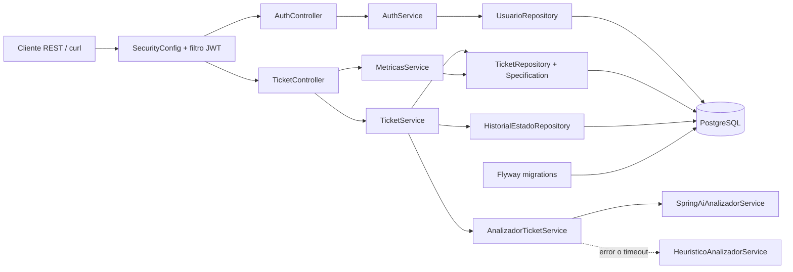
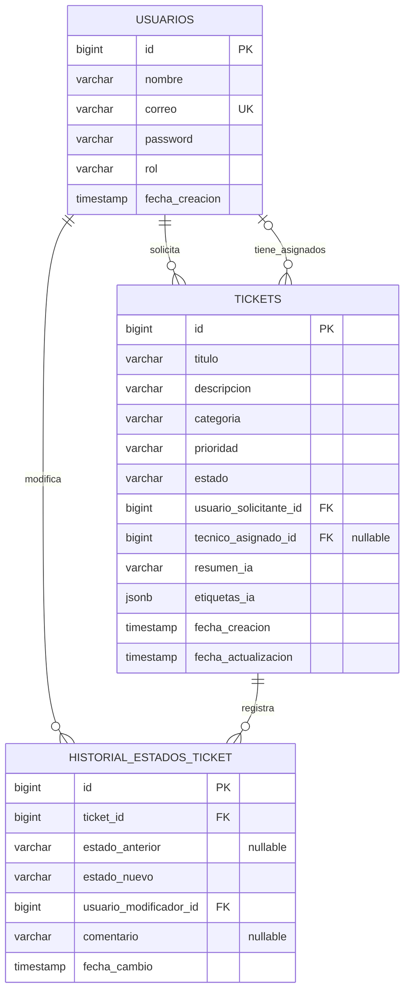

# Intelitickets

API REST para registrar y gestionar tickets de soporte técnico. Usa Java 21, Spring Boot, PostgreSQL, Flyway, autenticación JWT y clasificación asistida por Spring AI con fallback heurístico.

## Arquitectura



Los controladores reciben y devuelven DTOs. La capa de servicios aplica las reglas de negocio; los repositorios persisten usuarios, tickets e historial. `SecurityConfig` permite autenticación y documentación OpenAPI, y protege las demás rutas con JWT.

## Modelo de datos



Las migraciones Flyway crean el esquema y los usuarios iniciales en `src/main/resources/db/migration/`.

## Requisitos

- Java 21 para ejecución local.
- Docker y Docker Compose para iniciar PostgreSQL o desplegar la aplicación en contenedores.
- Una clave de API del proveedor configurado si se desea usar clasificación Spring AI. La clasificación manual de un ticket no necesita llamar al proveedor.

## Configuración

La aplicación lee las siguientes variables. `.env.example` contiene valores de ejemplo; cópialo a `.env` y configura los valores apropiados para tu entorno. No guardes secretos reales en el repositorio.

| Variable | Propósito | Ejemplo |
|---|---|---|
| `DB_URL` | URL JDBC de PostgreSQL | `jdbc:postgresql://localhost:5432/tickets_db` |
| `DB_USERNAME` | Usuario de PostgreSQL | `postgres` |
| `DB_PASSWORD` | Contraseña de PostgreSQL | `cambiar-para-tu-entorno` |
| `JWT_SECRET` | Secreto JWT de al menos 256 bits para HS256 | `<secreto-de-256-bits>` |
| `JWT_EXPIRATION_MS` | Vigencia del token en milisegundos | `86400000` |
| `AI_PROVIDER` | Proveedor Spring AI configurado | `openai` |
| `AI_API_KEY` | Clave del proveedor de IA | `<api-key>` |
| `AI_MODEL` | Modelo de chat | `gpt-4o-mini` |
| `AI_TIMEOUT_MS` | Timeout de llamada de IA en milisegundos | `8000` |
| `AI_RETRY_MAX_ATTEMPTS` | Intentos máximos para llamadas de IA con fallos transitorios | `2` |
| `AI_RETRY_BACKOFF_MS` | Espera inicial entre reintentos, en milisegundos | `250` |
| `CORS_ALLOWED_ORIGIN` | Origin único autorizado para solicitudes CORS del frontend | `http://localhost:5173` |

`CORS_ALLOWED_ORIGIN` debe contener un origin completo, con esquema, host y puerto cuando aplique, sin ruta ni slash final. En producción configura el dominio público del frontend. El backend no usa un origin wildcard ni un valor alternativo.

## Ejecución local

Desde este directorio:

```bash
cp .env.example .env
```

Edita `.env` para establecer un `JWT_SECRET` seguro, `CORS_ALLOWED_ORIGIN` con el origin del frontend y, si usarás clasificación IA, una clave válida en `AI_API_KEY`. Inicia PostgreSQL usando Compose:

```bash
docker compose up -d postgres
```

Exporta la configuración para el proceso local y ejecuta Spring Boot:

```bash
set -a
. ./.env
set +a
./mvnw spring-boot:run
```

Flyway aplica las migraciones al iniciar. La API queda disponible en `http://localhost:8080`.

## Despliegue con Docker Compose

Con Docker Compose instalado, crea `.env` como se indicó arriba y configura los secretos. Luego, desde este directorio:

```bash
docker compose up --build -d
docker compose logs -f app
```

Compose espera a que PostgreSQL esté saludable antes de iniciar la aplicación. Para detener los servicios:

```bash
docker compose down
```

El servicio publica la API en `http://localhost:8080`. `docker compose down -v` también elimina el volumen de datos de PostgreSQL.

## Documentación interactiva

Con la aplicación en ejecución, Swagger UI está disponible en `http://localhost:8080/swagger-ui.html` y el contrato OpenAPI en `http://localhost:8080/v3/api-docs`. La documentación es pública; las operaciones protegidas siguen requiriendo un token JWT.

## Pruebas y compilación

```bash
./mvnw test-compile
./mvnw test
./mvnw package
```

Las pruebas de integración usan PostgreSQL con Testcontainers, por lo que Docker debe estar disponible para ejecutar `./mvnw test`.

## Ejemplos de API

Las rutas `/api/auth/**` son públicas. Las rutas de tickets requieren `Authorization: Bearer <token>`. El registro crea una cuenta con rol `USUARIO`.

### Registrar y autenticar

```bash
curl -X POST http://localhost:8080/api/auth/register \
  -H 'Content-Type: application/json' \
  -d '{"nombre":"Ana Pérez","correo":"ana@example.com","password":"cambiar-esta-clave"}'
```

Inicia sesión para obtener el token:

```bash
curl -X POST http://localhost:8080/api/auth/login \
  -H 'Content-Type: application/json' \
  -d '{"correo":"ana@example.com","password":"cambiar-esta-clave"}'
```

La respuesta contiene el campo `token`. Asígnalo a una variable para los siguientes ejemplos:

```bash
TOKEN='<token-devuelto-por-login>'
```

### Crear un ticket con clasificación manual

Al enviar categoría y prioridad no se invoca el analizador de IA.

```bash
curl -i -X POST http://localhost:8080/api/tickets \
  -H "Authorization: Bearer $TOKEN" \
  -H 'Content-Type: application/json' \
  -d '{"titulo":"No funciona la impresora","descripcion":"La impresora de la oficina no responde desde esta mañana.","categoria":"HARDWARE","prioridad":"ALTA"}'
```

La respuesta es `201 Created` con un `TicketResponse` y encabezado `Location` para el recurso creado. La clasificación manual se refleja en `categoria`, `prioridad`, `resumenIA` y `etiquetasIA`.

### Listar y consultar tickets

```bash
curl -i 'http://localhost:8080/api/tickets?page=0&size=10&sort=fechaCreacion,desc&q=impresora' \
  -H "Authorization: Bearer $TOKEN"
```

Consulta el detalle reemplazando el ID con el valor recibido al crear el ticket:

```bash
curl -i http://localhost:8080/api/tickets/1 \
  -H "Authorization: Bearer $TOKEN"
```

Un usuario solo puede consultar tickets propios. La lista admite los filtros `estado`, `categoria`, `prioridad`, `usuarioId` y `q` además de `page`, `size` y `sort`.

### Operaciones de soporte

Las operaciones de cambio de estado, asignación, borrado lógico y métricas requieren rol `ADMIN` o `SOPORTE`.
Usa un token emitido para una cuenta con uno de esos roles; el registro público crea cuentas `USUARIO`.

```bash
STAFF_TOKEN='<token-de-usuario-ADMIN-o-SOPORTE>'
```

```bash
curl -i -X PATCH http://localhost:8080/api/tickets/1/estado \
  -H "Authorization: Bearer $STAFF_TOKEN" \
  -H 'Content-Type: application/json' \
  -d '{"estado":"EN_PROCESO","comentario":"Revisión iniciada"}'
```

```bash
curl -i -X PATCH http://localhost:8080/api/tickets/1/asignar \
  -H "Authorization: Bearer $STAFF_TOKEN" \
  -H 'Content-Type: application/json' \
  -d '{"tecnicoId":2}'
```

```bash
curl -i http://localhost:8080/api/tickets/metricas \
  -H "Authorization: Bearer $STAFF_TOKEN"
```

El borrado es lógico y requiere rol `ADMIN` o `SOPORTE`:

```bash
curl -i -X DELETE http://localhost:8080/api/tickets/1 \
  -H "Authorization: Bearer $STAFF_TOKEN"
```

### Gestión de usuarios

La gestión de usuarios requiere rol `ADMIN`, excepto el listado de personal de soporte, que requiere `SOPORTE`. El alta administrativa crea una cuenta con rol `SOPORTE`; el registro público de `/api/auth/register` crea cuentas `USUARIO`. La eliminación de usuarios es lógica.

```bash
# Listar usuarios (ADMIN)
curl -i 'http://localhost:8080/api/usuarios?page=0&size=10' \
  -H "Authorization: Bearer $ADMIN_TOKEN"

# Crear una cuenta de soporte (ADMIN)
curl -i -X POST http://localhost:8080/api/usuarios \
  -H "Authorization: Bearer $ADMIN_TOKEN" \
  -H 'Content-Type: application/json' \
  -d '{"nombre":"Carlos Ruiz","correo":"carlos@example.com","password":"cambiar-esta-clave"}'

# Listar personal de soporte (SOPORTE)
curl -i 'http://localhost:8080/api/usuarios/soporte?page=0&size=10' \
  -H "Authorization: Bearer $STAFF_TOKEN"

# Desactivar usuario (ADMIN)
curl -i -X DELETE http://localhost:8080/api/usuarios/2 \
  -H "Authorization: Bearer $ADMIN_TOKEN"
```

Las operaciones de borrado devuelven `204 No Content`. Los errores HTTP usan la estructura `ErrorResponse` con timestamp, status, error, message y path.
